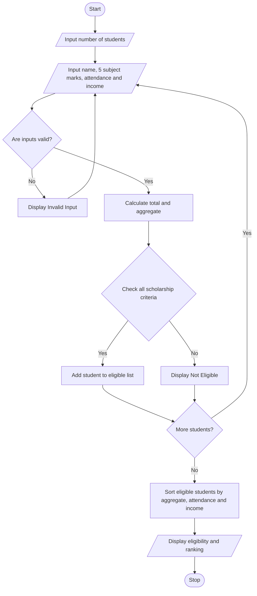

# Problem Statement
Develop a Python program to determine whether a student is eligible for a university scholarship based on aggregate marks, subject-wise minimum marks, attendance, and annual family income. The program should rank eligible students using predefined rules: higher aggregate percentage first, followed by higher attendance, and then lower family income in case of a tie.
# Algorithm
1. Start the program.
2. Input the student's name, marks in five subjects, attendance percentage, and annual family income.
3. Check that all marks and attendance are between 0 and 100, and income is non-negative.
4. Calculate total marks and aggregate percentage.
5. Check whether:
   - Aggregate percentage is at least 85%.
   - Every subject mark is at least 75.
   - Attendance is at least 75%.
   - Annual family income is at most ₹2,50,000.
6. If all conditions are satisfied, display Eligible for Scholarship. Otherwise, display Not Eligible with the reason.
7. When comparing eligible students, rank by aggregate percentage, then attendance, then lower family income.
8. Stop.
These thresholds are assumptions for this educational program.

# Sample Input
For this example, enter two students.
Enter number of students: 2

Student 1
Enter name: Asha
Enter subject mark: 90
Enter subject mark: 92
Enter subject mark: 88
Enter subject mark: 91
Enter subject mark: 89
Enter attendance percentage: 90
Enter annual family income: 200000

Student 2
Enter name: Ravi
Enter subject mark: 80
Enter subject mark: 85
Enter subject mark: 90
Enter subject mark: 88
Enter subject mark: 87
Enter attendance percentage: 95
Enter annual family income: 180000

# Sample Output
Student 1
Eligible for Scholarship

Student 2
Eligible for Scholarship

Scholarship Ranking
1 Asha Percentage: 90.0 Attendance: 90.0 Income: 200000.0
2 Ravi Percentage: 86.0 Attendance: 95.0 Income: 180000.0
