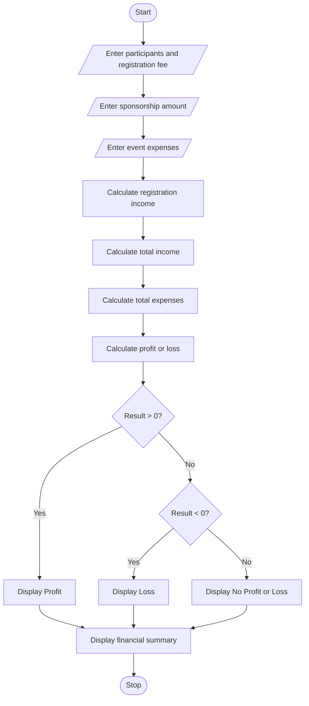

# Problem Statement
Develop a Python program to plan and analyze the finances of a campus event. The program accepts the expected number of participants, registration fee per participant, sponsorship amount, and event expenses such as food, decoration, and transportation. It calculates the total income, total expenses, and final profit or loss to determine whether the event is financially successful.
# Algorithm
1. Start the program.
2. Enter the number of participants.
3. Enter the registration fee per participant.
4. Enter the sponsorship amount.
5. Enter the expenses for food, decoration, and transportation.
6. Calculate registration income by multiplying participants by the registration fee.
7. Calculate total income by adding registration income and sponsorship.
8. Calculate total expenses by adding all event expenses.
9. Calculate profit or loss by subtracting total expenses from total income.
10. Display total income, total expenses, and profit or loss.
11. Stop the program.

# Sample Input
Enter number of participants: 100
Enter registration fee per participant: 200
Enter sponsorship amount: 10000
Enter food expenses: 8000
Enter decoration expenses: 5000
Enter transportation expenses: 3000

# Sample Output
Total registration income = 20000.0
Total income = 30000.0
Total expenses = 16000.0
Profit = 14000.0
