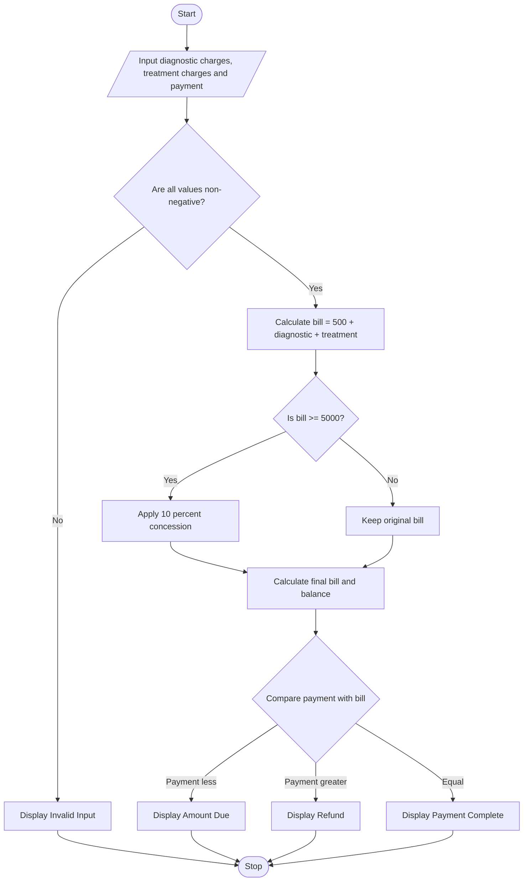

# Problem Statement
Develop a Python program to calculate a patient's hospital bill based on registration charges, diagnostic charges, and treatment charges. Apply a 10% concession if the bill before concession is ₹5,000 or more. Calculate the final bill, compare it with the amount paid, and classify the payment status as Amount Due, Refund, or Payment Complete.
# Algorithm
1. Start the program.
2. Input diagnostic charges, treatment charges, and amount paid.
3. Check whether all input values are non-negative.
4. Add the registration charge of ₹500 to diagnostic and treatment charges.
5. If the bill is ₹5,000 or more, apply a 10% concession.
6. Calculate the final bill after concession.
7. Compare the final bill with the amount paid.
8. If the amount paid is less than the bill, display the amount due.
9. If the amount paid is greater than the bill, display the refund amount.
10. Otherwise, display Payment Complete.
11. Stop.

#. Sample Input
Enter diagnostic charges: 2000
Enter treatment charges: 3000
Enter amount paid: 2000

# Sample Output
Final Hospital Bill: Rs. 4950.0
Amount Due: Rs. 2950.0

# Calculation
- Registration charge = ₹500
- Diagnostic charges = ₹2,000
- Treatment charges = ₹3,000
- Total before concession = ₹5,500
- Concession = 10% of ₹5,500 = ₹550
- Final bill = ₹5,500 − ₹550 = ₹4,950
- Amount due = ₹4,950 − ₹2,000 = ₹2,950
Result: The patient's final hospital bill is ₹4,950, and the remaining amount due is ₹2,950.
