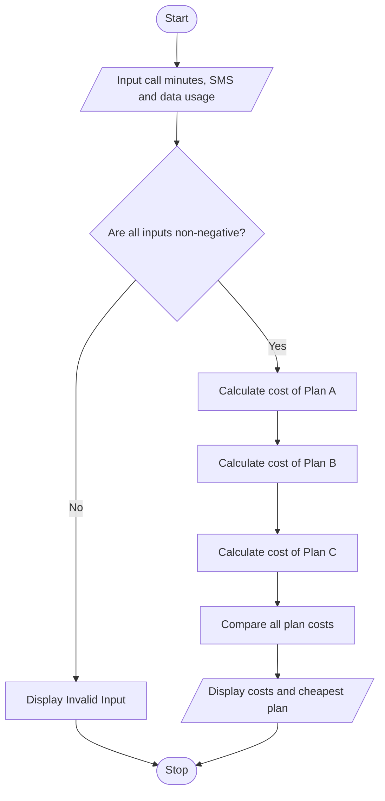

# Problem Statement
Develop a Python program to calculate and compare the monthly cost of different telecommunications plans based on call minutes, SMS messages, and mobile data usage. Each plan has a fixed monthly charge and additional usage charges. The program should calculate the total cost of each plan and recommend the most economical plan that meets the user's requirements.
# Algorithm
1. Start the program.
2. Input monthly call minutes, number of SMS messages, and data usage in GB.
3. Validate that all usage values are non-negative.
4. Define three plans with different fixed charges and usage rates.
5. For each plan, calculate:
   - Call charges.
   - SMS charges.
   - Data charges.
   - Total monthly cost = fixed charge + all usage charges.
6. Compare the total cost of all plans.
7. Identify the plan with the lowest monthly cost.
8. Display each plan's cost and recommend the cheapest plan.
9. Stop.

# Sample Input
Enter call minutes: 100
Enter number of SMS: 50
Enter data usage in GB: 5

# Sample Output
Plan A Cost: Rs. 304.0
Plan B Cost: Rs. 314.0
Plan C Cost: Rs. 349.0
Cheapest Plan: Plan A

# Sample Plan Details
Plan	Fixed charge	Call rate/min	SMS rate	Data rate/GB
A	₹99	₹0.80	₹0.50	₹20
B	₹199	₹0.50	₹0.30	₹10
C	₹299	₹0.20	₹0.10	₹5

Result: For the given usage, Plan A is the most economical option, costing ₹304 per month.
