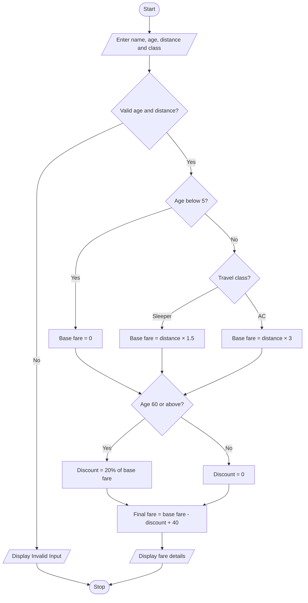

# Problem Statement
Develop a Python program to calculate railway ticket fares based on the distance travelled, passenger age, and travel class. The program should calculate the total fare, apply concessions for senior citizens, and display the final reservation amount.
# Algorithm
1. Start.
2. Read passenger name, age, distance, and travel class.
3. Check whether age and distance are valid.
4. If the passenger is below 5 years, set the base fare to zero.
5. Otherwise, calculate the fare according to the selected class.
6. If the passenger is 60 years or older, apply a 20% discount.
7. Add the reservation charge of ₹40.
8. Display the base fare, discount, reservation charge, and final fare.
9. Stop.

# Sample Input
Enter passenger name: Sajida
Enter passenger age: 65
Enter distance in km: 200
Enter class (Sleeper/AC): Sleeper

# Sample Output
--- Railway Ticket Details ---
Passenger Name: Sajida
Base Fare: Rs. 300.0
Discount: Rs. 60.0
Reservation Charge: Rs. 40
Final Fare: Rs. 280.0

# Conclusion
The Railway Fare and Reservation Calculator calculates ticket fares based on travel distance and class, applies the senior-citizen concession, and adds the reservation charge to display the final amount payable.
