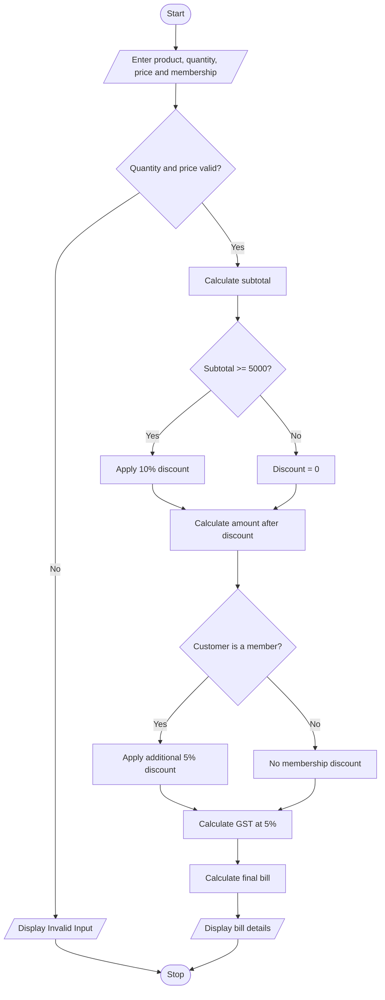

# Problem Statement
Develop a Python program to generate a retail bill by accepting the product name, quantity, and price per item. The program should calculate the total amount, apply discounts based on purchase value and customer membership, add GST, and display the final bill
# Algorithm
1. Start.
2. Input the product name, quantity, price per item, and membership status.
3. Check whether quantity and price are valid.
4. Calculate the subtotal: quantity × price.
5. If subtotal is ₹5,000 or more, calculate a 10% discount.
6. If the customer is a member, apply an additional 5% discount to the remaining amount.
7. Calculate GST at 5% on the discounted amount.
8. Calculate the final bill by adding GST.
9. Display subtotal, discounts, GST, and final bill.
10. Stop.

# Sample Input
Enter product name: School Bag
Enter quantity: 2
Enter price per item: 3000
Is customer a member? (yes/no): yes

# Sample Output
--- Retail Bill ---
Product: School Bag
Subtotal: Rs. 6000.0
Purchase Discount: Rs. 600.0
Member Discount: Rs. 270.0
GST: Rs. 256.5
Final Bill: Rs. 5386.5

Calculation:
- Subtotal = 2 × ₹3,000 = ₹6,000
- Purchase discount = 10% of ₹6,000 = ₹600
- Member discount = 5% of ₹5,400 = ₹270
- Taxable amount = ₹5,130
- GST = 5% of ₹5,130 = ₹256.50
- Final bill = ₹5,386.50
# Conclusion
The Retail Billing System calculates the purchase amount, applies multiple discount rules, adds GST, and displays the final bill. It helps make retail billing simple, accurate, and efficient.
