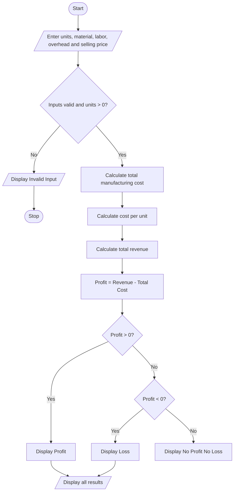

# Problem Statement
Develop a Python program to calculate the total manufacturing cost, cost per unit, total revenue, and profit or loss of a product. The program should accept raw material cost, labor cost, overhead cost, number of units produced, and selling price per unit. It should determine whether the business earns a profit or incurs a loss.
# Algorithm
1. Start.
2. Input the number of units produced, raw material cost, labor cost, overhead cost, and selling price per unit.
3. Check whether all inputs are valid.
4. Calculate total manufacturing cost by adding raw material, labor, and overhead costs.
5. Calculate cost per unit by dividing total manufacturing cost by units produced.
6. Calculate total revenue by multiplying units produced by selling price per unit.
7. Calculate profit or loss by subtracting total manufacturing cost from total revenue.
8. Display the total cost, cost per unit, revenue, and profit or loss.
9. Stop.

# Sample Input
Enter units produced: 100
Enter raw material cost: 10000
Enter labor cost: 5000
Enter overhead cost: 2000
Enter selling price per unit: 250

# Sample Output
Total Manufacturing Cost: Rs. 17000.0
Cost Per Unit: Rs. 170.0
Total Revenue: Rs. 25000.0
Profit: Rs. 8000.0

# Calculation
- Total manufacturing cost = ₹10,000 + ₹5,000 + ₹2,000 = ₹17,000
- Cost per unit = ₹17,000 ÷ 100 = ₹170
- Total revenue = 100 × ₹250 = ₹25,000
- Profit = ₹25,000 − ₹17,000 = ₹8,000
    M --> N
    N --> Z
