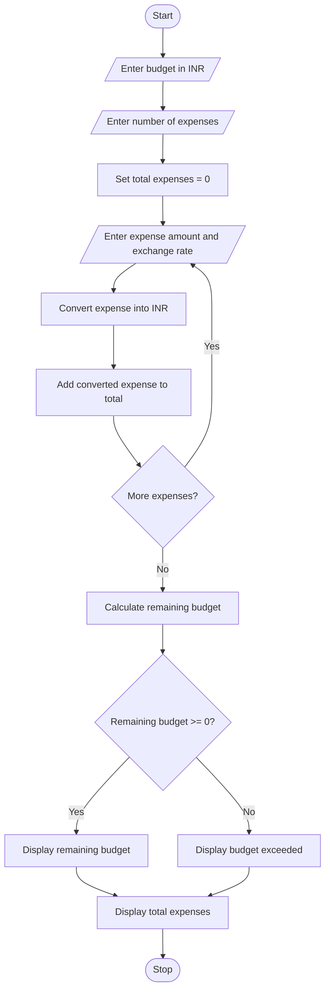

# Problem Statement
Develop a Python program to calculate and analyze a travel budget when expenses are recorded in different currencies. The program accepts the travel budget in Indian Rupees (INR), the expenses in foreign currencies, and their exchange rates. It converts each expense into INR, calculates the total travel expenses, determines the remaining budget, and displays whether the traveler stayed within the budget or exceeded it.
# Algorithm
1. Start the program.
2. Read the total travel budget in INR.
3. Read the number of travel expenses.
4. For each expense, enter the expense name, amount, and exchange rate in INR.
5. Convert each expense into INR by multiplying the amount by its exchange rate.
6. Add all converted expenses to calculate the total expenses.
7. Calculate the remaining budget by subtracting total expenses from the budget.
8. If the remaining budget is positive or zero, display the remaining amount; otherwise, display the amount exceeded.
9. Display the total expenses and budget status.
10. Stop the program.

# Sample Input
Enter travel budget in INR: 50000
Enter number of expenses: 3

Expense 1
Enter expense name: Hotel
Enter amount in foreign currency: 100
Enter exchange rate in INR: 85

Expense 2
Enter expense name: Food
Enter amount in foreign currency: 50
Enter exchange rate in INR: 85

Expense 3
Enter expense name: Shopping
Enter amount in foreign currency: 100
Enter exchange rate in INR: 85

# Sample Output
Hotel in INR = 8500.0
Food in INR = 4250.0
Shopping in INR = 8500.0

Total expenses in INR = 21250.0
Remaining budget in INR = 28750.0
Status: Within budget

# Conclusion
The Multi-Currency Travel Budget Analysis program converts expenses from different currencies into Indian Rupees using the provided exchange rates. It calculates total expenses and the remaining budget, helping travelers manage their spending effectively.
